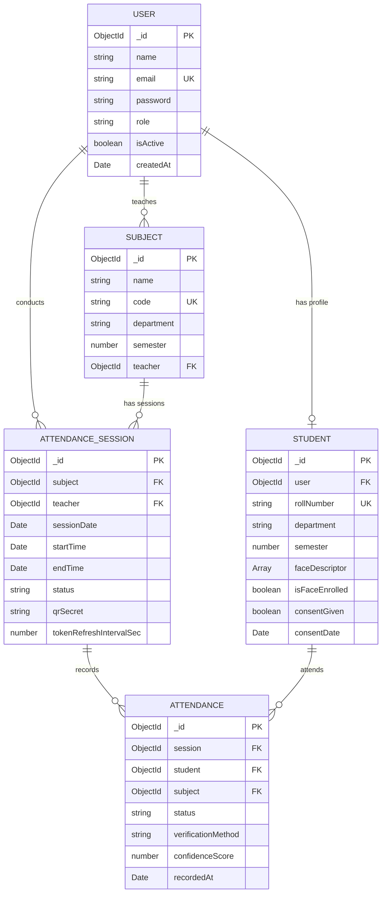

# Database Schema & Mongoose Models

The application uses MongoDB via Mongoose ODM.

---

## Entity Relationship Overview

---

## Collections Specification

### 1. `users`
- Stores primary authentication credentials and RBAC roles (`student`, `teacher`, `admin`).
- **Indexes**: `{ email: 1 }` (unique).

### 2. `students`
- Extends the `User` model with academic details and 128-dimensional biometric facial descriptors.
- **Indexes**: `{ user: 1 }` (unique), `{ rollNumber: 1 }` (unique).
- **Security**: `faceDescriptor` is marked `{ select: false }` so that it is never returned in standard queries.

### 3. `subjects`
- Stores course metadata, syllabus department, and the assigned faculty member.
- **Indexes**: `{ code: 1 }` (unique), `{ teacher: 1 }`.

### 4. `attendancesessions`
- Represents a discrete class lecture or lab.
- Contains the cryptographic `qrSecret` used as a rotating HMAC seed for dynamic QR generation.

### 5. `attendances`
- An individual verified attendance instance.
- **Indexes**: Composite unique index `{ session: 1, student: 1 }` preventing double-marking.
